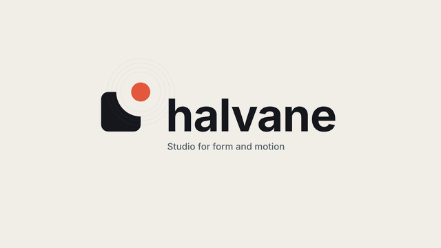
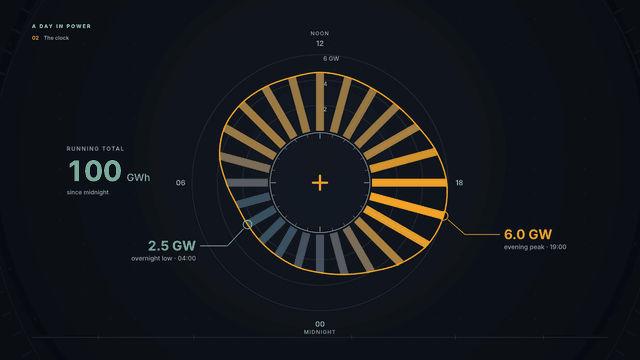

# nakkash

**An open-source, AI-native engine for programmable motion graphics and video.**

Describe a video as a small scene file. nakkash checks it, edits it and renders it, with no browser and nothing else to install.


- **Scenes are data.** A few lines say what should happen; nakkash works out every frame.
- **Made for agents.** One-line edits, checks that answer in numbers, and no frames to look at.
- **Native rendering.** Float-precision compositing, true motion blur, H.264/HEVC/ProRes/AV1 straight out.
- **Existing work comes in.** `.aep` projects and `.mogrt` templates import as scenes ([compatibility](docs/compatibility.md)).

**Status:** early development; build from source. The project was called motion until 2026-11-17 ([why nakkash](docs/design/decisions.md#d73-the-project-is-named-nakkash)).

## Showcase

Every frame below is rendered by nakkash from a scene file in this repository.

| | | |
|:---:|:---:|:---:|
| [](examples/showcase/product-launch.json) | [](examples/showcase/brand-system.json) | [](examples/showcase/data-story.json) |
| Product launch | Brand system | Data story |
| [](examples/advanced/kinetic-type.json) | [](examples/advanced/shape-mark.json) | [](examples/advanced/camera-depth.json) |
| Kinetic type | Shapes | Camera and depth |

More: [showcase](examples/showcase/README.md) · [advanced examples](examples/advanced/README.md) · [examples](examples/README.md)

## Try it

```
cargo run -q -p nakkash-cli -- render examples/launch.json --out /tmp/launch.mp4
```

The first build compiles the workspace once. Then open the scene, change a word or a colour, and render again.

## Documentation

- [Getting started](docs/guide/getting-started.md): why nakkash, use cases, every command.
- [Scene format](docs/design/scene-format.md): every key a scene can hold.
- [Writing a video from scratch](docs/guide/from-scratch.md): the guide for agents.
- [Filling a template](docs/guide/fill-a-template.md): how an agent makes a variant of a template from its brief and an instance.
- [Compatibility](docs/compatibility.md): `.aep`, `.mogrt`, vector footage, what is planned.
- [All documentation](docs/README.md) · [Architecture](ARCHITECTURE.md) · [Contributing](CONTRIBUTING.md)

Rust developers, motion designers and people who work in desktop compositing tools are all welcome: see [Contributing](CONTRIBUTING.md).

## Licence

Apache-2.0 or MIT, at your option. See [LICENSE-APACHE](LICENSE-APACHE) and [LICENSE-MIT](LICENSE-MIT).
