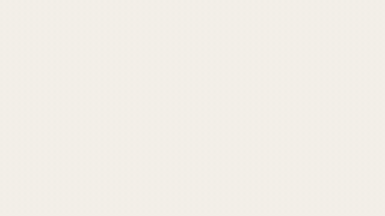
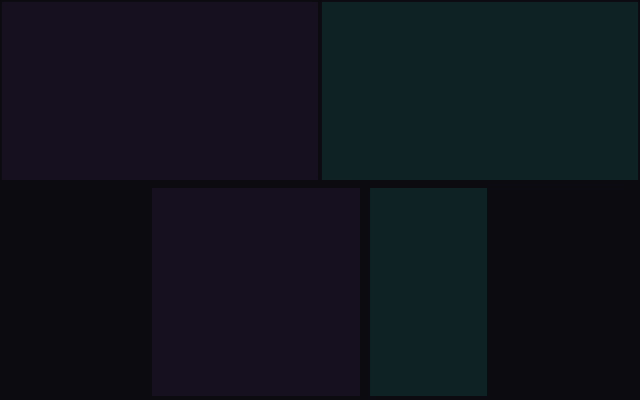

# Advanced examples

Five scenes written from scratch that use what nakkash can do: text animators, shape operations, a 2.5D camera, nested compositions with effects, and one master that `nakkash batch` turns into several formats. Each scene uses the built-in `Inter Variable` and needs no media files.

Each scene has one small motion system, and every move in it uses the same few curves and durations:

| Curve | Used for |
|---|---|
| `cubic(.16,1,.3,1)`, 16–24 frames | entrances: fast off the mark, long settle |
| `cubic(.7,0,.84,0)`, 12–16 frames | exits: slow start, then gone |
| `in-out-cubic` / `cubic(.65,0,.35,1)` | moves from one rest to another: draws, wipes, data changes |
| `in-out-sine`, whole clip | camera moves and drifts, so the speed never jumps |
| `out-back(1)` / `cubic(.34,1.4,.64,1)` | emphasis, overshooting by about 4 % |

Staggers are 2 frames (67 ms at 30 fps). Each text stays readable for longer than it takes to read, which `check` enforces. A test checks that each scene passes `nakkash check` with nothing found, and that the batch makes every variant (`crates/nakkash-cli/tests/examples_advanced.rs`).

To render any scene:

```sh
nakkash render examples/advanced/<scene>.json --out <scene>.mp4
```

## Kinetic typography


[`kinetic-type.json`](kinetic-type.json), 10 s. A short manifesto about letters: "Every letter has a job", then ENTER, HOLD and LEAVE each doing what the word says, then "Motion is meaning." filling in from its outline.

- **Text animators** with `range` selectors by `char`, `char-no-space` and `word`. An entrance and an exit on the same text are two animators, so each starts from rest.
- **Selector shapes:** a `smooth` wave with `ease-high` and `ease-low` lifts and lightens "has a job."; a `triangle` passes a colour through HOLD; a `ramp-up` on a moving `offset` makes LEAVE stream off to the right.
- **Stagger orders:** `first`, `center` (ENTER grows from its middle) and `edges` (it leaves from both ends).
- **What animators change:** `position`, `rotate`, `scale`, `opacity`, `tracking` (the first line closes up from wide spacing), `fill` (a transparent fill turns outlines solid), and the `stroke` and `paint-across` style keys.
- **`anchor-by` `word`** with `anchor-align`, so the words of the last line turn and scale as wholes about a point above their baseline.
- **Labels** (`verbs`, `close`) set the beats; spans and offsets are written against them.
- A trim-path underline and a radial `ramp` backdrop.

## Shape design



[`shape-mark.json`](shape-mark.json), 7 s. A mark builds itself: a ring draws on, 24 ticks count in around it, a crescent is cut from a disc, a rounded triangle turns into place, and a ripple spreads out once. Then the wordmark is wiped in and the tagline is revealed.

- **Trim paths:** the ring draws on with `end` while its `offset` turns, so the stroke sweeps round as it grows.
- **Repeater:** one tick copied 24 times about the centre. `copies` animates so the ticks fade in one by one, and `offset` turns them by a step during the hold. The fade from `start-opacity` to `end-opacity` stays where it is while the ticks move, so a darker band seems to sweep round.
- **Merge `subtract`:** a second circle slides across the disc along a curved spatial path (`path` handles on its position keys), and the crescent is what is left.
- **`round-corners`** on a `star` `polygon`.
- **`expand`** with `copies` and an animated `copy-offset`: three rings grow out of the crescent.
- **A mask** with an animated path and `feather` wipes in the wordmark.
- **A track matte** (`"matte":"wipe"`): the tagline shows only where a hidden bar is, and the bar grows from its left edge.
- A `pivot` turns the whole mark a few degrees over the clip.

## Camera and depth


[`camera-depth.json`](camera-depth.json), 8 s (the GIF shows the first 5 s). Dusk over four ridges. The camera moves in and across while it keeps looking at one point, so each ridge slides past the others at its own speed.

- **`3d` layers** at depths from 300 to 3200 px, with the near ridges drawn in front of the far ones.
- **A `camera`** whose `position` and `z` move over the whole clip with `in-out-sine`. It keeps looking at a fixed `target`, which turns it gently, and it rolls slightly through `orient`.
- **`rotate-x`** flips the title up into place and **`rotate-y`** swings the subtitle in, both in the scene's 3D space.
- **Motion blur:** a comet crosses the sky with `mblur`, under the scene's `shutter`.
- **Atmosphere:** a haze plane between the ridges, with a `ramp` from clear to warm and `blend` `screen`, and a `glow` on the sun.
- The ridges are smooth curves: no join between two curves turns.

## Product and UI reveal


[`ui-reveal.json`](ui-reveal.json), 8 s. A weekly-summary card comes into focus beside its headline. A bar chart grows and its rows slide in, a sheen crosses the card, and two call-outs pop out at its corners. Later the chart moves on to new numbers.

- **Nested compositions:** `screen` holds `chart` and three `row` instances; each row and each `chip` call-out sets its composition's slots through `overrides` (`"$label"`, `"$value"`, `"$tone"`).
- **`collapse`** on the screen, so its layers draw straight into the scene under the card's transform.
- **Time remap:** the chart composition plays once, holds on its first state, then moves on to its second state in one second (`remap` keys with `hold` and `in-out-cubic`).
- **Effects:** `gaussian-blur` racks the card into focus; `drop-shadow`, `glow` on the highlighted bar and the call-out dots, a `four-color` gradient backdrop, and a `beam` that draws the headline's underline.
- **Blend modes and mattes:** the sheen is `add`-blended and matted to a hidden copy of the card's shape; a soft blurred orb is blended with `screen`.
- **A `pivot`** carries the card, its sheen and the call-outs, and floats them as one.
- **`in` behaviours** on words and whole layers (`fade-up word … stagger 2f`, `pop`), and `mblur` on the moves that would otherwise judder.

## Programmable variants



[`variants/master.json`](variants/master.json) and [`variants/batch.json`](variants/batch.json), 6 s each. One master announcement, and a batch that makes four variants from it: the original, new copy and colours, a square cut and a 9:16 cut.

- **`slots`** hold what changes: `$headline`, `$details`, `$cta`, `$accent` and `$ink`. Every value written `"$accent"` (the mark, the ring of dots and the button) follows one edit.
- **`roles`** say what the layers and slots do, at any depth: `cta` is `button/label`, inside a composition.
- **`locks`** keep `@mark` and `typefaces` as the designer set them.
- **One project, many formats:** the content sits under a centred `stage` pivot, so `scene size=1080x1920` puts it in the middle of the new canvas and `@stage scale=0.86` fits it.

```sh
nakkash roles examples/advanced/variants/master.json
nakkash slots examples/advanced/variants/master.json
nakkash batch examples/advanced/variants/batch.json          # writes variants/out/<id>.mp4 and .json
nakkash batch examples/advanced/variants/batch.json --check  # applies and checks, renders nothing
```

```text
wide            0 edits  check OK  out/wide.mp4  0.5 s
wide-teal       4 edits  check OK  out/wide-teal.mp4  0.4 s
square          3 edits  check OK  out/square.mp4  0.3 s
vertical-teal   6 edits  check OK  out/vertical-teal.mp4  0.4 s
4 rendered, 0 refused, 0 failed their check
```

Each variant is checked before it renders, so a headline too long for the square cut is reported (`check failed: E offscreen headline …`) and that variant is not rendered. The batch runs the scene's rules but not yet the pixel gates, `contrast` and `flash`, so run `nakkash check` on a variant's `out/<id>.json` for those. Edits that touch a lock are refused:

```text
$ nakkash edit master.json '@mark scale=1.4'
error: `mark` is locked by `@mark`; expected an edit of what the scene does not lock; the designer changes `locks`
$ nakkash edit master.json '@headline font="Georgia 150 700"'
error: `Georgia` is not one of the scene's typefaces, which are locked by `typefaces`; expected an edit of what the scene does not lock; the designer changes `locks`
```
