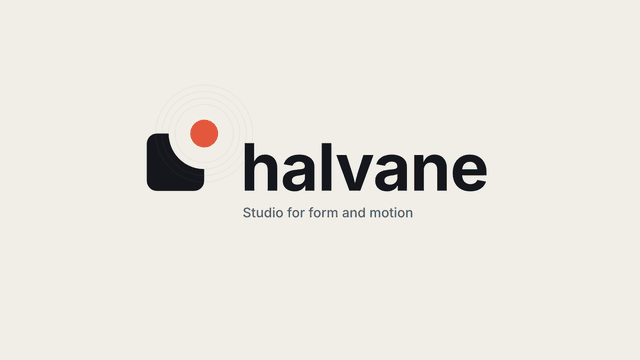

# Showcase sequences

Long, dense films written from scratch, each in several acts, with something meaningful moving at every moment. They use only the built-in `Inter Variable` and no media files, invent their products, brands and data, and pass `nakkash check` with nothing found; a test in `crates/nakkash-cli/tests/showcase.rs` keeps each one so. The [examples](../README.md) show one idea each; these show how the ideas combine at the scale of a finished piece.

## Product launch


[`product-launch.json`](product-launch.json), 1920x1080, 30 fps, 39 s. A launch film for Arclet, an invented task app, in eight acts. The beats are root `labels`; each act is a composition drawn by one `comp` layer.

| Act | Time | What happens |
|---|---|---|
| Hook | 0–3.7 s | "Everything is urgent." is readable at frame 0 while nine columns of notifications scroll past at their own depths, far ones blurred; "So nothing is." answers at 1.1 s. |
| Problem | 3.1–9.1 s | Pushed in from below. Five notifications drop onto a stack, each pushing the older ones down as one body; an unread badge rolls its count and runs to "9+". The stack folds into one card, which becomes the app's tile. |
| Reveal | 9.1–13.3 s | The tile grows into a phone's screen as the phone turns in, a light sweeps the glass, the splash wipes up and the list arrives. "Meet Arclet." |
| Priorities | 13.3–18.3 s | A chip turns "Urgent"; its row lifts, casts a deeper shadow and rises to the top while the rows it passes dim and make room. A task is checked off, struck through and sinks to the bottom; the progress bar and its count follow. |
| Focus | 18.3–24.7 s | A circular wipe from the checked box opens the focus screen as the phone swings across. Three toggles flip in turn; three alerts arrive and fly into a digest card, each leaving a dot. |
| Insight | 24.7–31.7 s | The week screen pushes in. The camera pulls back while the chart card lifts out of the phone and lands full size: the same composition at the same moment, so the hand-off is exact. Bars and gridlines grow, a trend line draws, the best day turns brand colour and gets a label. |
| Statement | 31.7–35.4 s | The best day's bar grows until it is the frame. "Less noise." assembles from scattered, turned characters; "More done." lands; rings drift behind. |
| End card | 35.4–39 s | The field closes into the tile, the mark draws on, the dot lands in a notch cut from the tile, ticks burst once, and the name, tagline and call to action settle. Complete at 37.6 s and held to the end. |

### The motion system

Every move uses one of five curves, each starting from rest so no move jumps from standing to full speed between frames:

| Curve | Used for |
|---|---|
| `cubic(.4,0,.2,1)`, 20–34 frames, longer for longer moves | entrances |
| `cubic(.65,0,.35,1)` | moves from rest to rest: re-sorts, pushes, wipes, data changes |
| `cubic(.55,0,.8,.25)` | exits: slow start, gone at speed |
| `cubic(.45,0,.55,1)` | camera, rig and long moves, one key pair each |
| `cubic(.4,0,.25,1.3)` | emphasis where something lands: 4.5 % overshoot |

Opacity follows the move it belongs to (`out-quad` in, `in-quad` out, starting a few frames after the move), and is never linear on a moving layer. Parts of a text take turns 1 to 3 frames apart (33–100 ms); grouped elements follow their leader 2 frames apart.

### What it uses

- **Text animators:** per character, word and line, with `random`, `center` and `last` orders; blur, skew, rotation, tracking and scale that clear as each part lands; a slow tracking drift over a hold; exits that are animators of their own.
- **Shapes:** repeaters that scroll the feeds (the layer stands still, its copies move) and lay out a plane of dots with two nested repeaters; `trim` on gridlines, a check mark, a trend line, a ring, an outline and the logo; `merge` `subtract` cutting the notch for the dot; `round-corners` rounding the closing field into the tile; `expand` rings and a `repeater` burst of ticks.
- **Masks and mattes:** a circular mask, its vertex count fixed, that wipes the focus screen open; a rounded mask on the phone's screen; light sweeps through a hidden screen-shaped matte.
- **Compositions:** 16, nested up to four deep. Rows, toggles and alerts are `collapse`d instances with `slots`; the app is drawn at twice its size for the pull-back; a notification stack is a parent chain, so one arrival moves every older card as one body.
- **2.5D:** a camera that drifts and pulls back with `target`; a 3D phone rig turned by a 3D pivot; feeds, a halo and a dot plane at their own depths, blurred by distance.
- **Effects and blending:** `four-color`, `ramp`, `gaussian-blur` for depth of field, `drop-shadow`, `glow`, `add` and `screen` blends, motion blur with a per-composition shutter.

### Numbers

| Measure | Value |
|---|---|
| `nakkash check` | `OK 742`, nothing found |
| Compositions, layers | 16 compositions, 170 layers written, 256 drawn once compositions are expanded |
| Animation | 284 tracks, 739 keyframes, 126 text animators, 418 shape items and effects |
| Elements in motion | 9.5 per frame on average (7.5 without the two background glows), up to 29; no frame where nothing moves; the longest stretch with only the glows moving is the 16-frame hold at the end |
| Smoothness | 25 main movers sampled every frame with `nakkash at`: no change of velocity between two frames above 25 % of the mover's peak speed |
| Paths | no turn above 10° between two frames while a mover goes faster than 10 % of its peak speed |
| Render | 289 s for 1172 frames on a 12-core laptop (about 4 frames a second), H.264 |

An element is a layer, shape item, effect, mask or text animator with a track, counted while that track moves and its layer shows.

The test runs `check`'s rules over every frame, in 6 s in a debug build. The pixel gates (`contrast`, `flash`) draw the film, which takes about 16 minutes in a debug build, so after an edit run `nakkash check` from a release build, where the whole check takes about 10 s.

To render it:

```sh
nakkash render examples/showcase/product-launch.json --out product-launch.mp4
```

## Brand identity system



[`brand-system.json`](brand-system.json), 1920x1080, 30 fps, 32 s. The identity of a fictional studio, Halvane, built in front of you: a construction sheet draws itself, the mark is made from its geometry, the wordmark sets, the palette, pattern and applications follow, and it ends on the lockup it started from. The GIF shows 13.0–19.2 s, drawn without the film's grain to stay small.

```sh
nakkash render examples/showcase/brand-system.json --out brand-system.mp4
```

| Act | Label | What happens |
|---|---|---|
| 1. Construction | `construct` 0 s | Crop marks, a ruler and guides through the golden divisions draw from their middles; five rings of radius 320/φⁿ sweep on; the golden spiral draws through them; crosshairs, dimension lines and a spec column tick in. |
| 2. Mark | `mark` 3.9 s | The tile's outline and the dot's ring draw; the tile fills as the guides fade; the bite grows out of the dot (`expand` from −75 to 122, φ² of the dot) and is cut from the tile (`merge` `subtract`), with ripples; the corners round (`round-corners` 0 → 56); a light sweep crosses it. |
| 3. Wordmark | `word` 8.7 s | The mark moves into the lockup under motion blur. Type metrics draw; the letters rise out of a baseline slot one by one, skewed and blurred, while the tracking closes from +260 to −12 over two seconds; an ember wave runs through the letters and an echo ripples from the dot. |
| 4. Colour | `palette` 13.2 s | The palette opens through the mark's own outline (two masks whose paths scale ×24 about a point in the tile) while the identity pushes in. Five swatches grow; names rise, hex codes settle in random order, RGB values tick in, and two digit wheels per swatch roll to its share; a stacked bar grows, a ring draws round the accent, a wave lifts the swatches. |
| 5. Pattern | `pattern` 17.9 s | Pushed in with motion blur. One shape layer: the mark, a repeater that turns every other copy (0 → 90°), a second that turns the pair (0 → 180°) to make a 2x2 pinwheel, and two that tile it, with a scale ramp and a slow diagonal offset. |
| 6. Applications | `apps` 22.7 s | The pattern shrinks into a sheet-framed window and becomes a display; the camera pulls back past a phone and two business cards to a wayfinding sign in one move, over a drafting-grid floor, with a pane of registration crosses close to the lens. |
| 7. Lockup | `lockup` 28.7 s | The sign's dot grows to fill the frame and closes into the lockup's dot; the tile, wordmark and tagline arrive, construction rings redraw round the dot, crop marks return, and a sweep crosses the word. Complete at 30.7 s, holding 1.3 s while the rings and sweep finish. |

**The motion system.** Every move uses one of five curves, and durations grow with distance (12 frames plus one per 40 px, up to 30):

| Curve | Used for |
|---|---|
| `cubic(.16,1,.3,1)` | entrances: fast off the mark, long settle |
| `cubic(.7,0,.84,0)` | exits |
| `cubic(.65,0,.35,1)` | moves from rest to rest, relayouts, bites, turns |
| `cubic(.45,0,.2,1)` | line draws |
| `in-out-sine` | the camera and drifts, one key pair each |
| `out-back(1)` | landings only, 3.7 % overshoot |

Staggers are 2 frames (67 ms). A move leads and its fade follows: opacity has its own animator or track, on `out-sine`, never linear on a moving thing.

**What it uses.** Text animators by character and word with `range` selectors in fraction and `index` units, `ease-high`/`ease-low` on a `triangle` wave, `tracking`, `blur`, `skew`, random `order` with `seed`; trims with offsets, `merge` `subtract`, `round-corners`, `expand` with `copies` and `copy-offset`, four nested repeaters; masks with keyed paths and track mattes; ten compositions with slots and `overrides` (the digit wheel is one composition used ten times), pivots and parenting; a 2.5D camera with `target`, `target-z` and `orient`, 3D planes and shadow planes; `remap` (the display keeps playing the pattern, slowing to a stop); `fractal-noise` grain under `overlay`, `glow`, `gaussian-blur`, `screen` sweeps; motion blur on pivots, pushes and compositions; `in`/`out` presets and labels.

**Numbers.** 152 layers in 10 compositions, 649 keyframes. On average 8.1 animated values are changing in any frame, and no second has fewer than 2.8. `nakkash check` prints `OK 488`. Sampled every frame with `nakkash at`, the mark's move, the palette's push, the pattern's push and scale, and the camera have no frame-to-frame speed change above 25 % of their peak. The zoom into the palette, evaluated from its curve, accelerates smoothly into its cut. Of the 58 joins in the scene's curved paths, none turns by more than 10°. Rendering takes 95–210 s on an M-series Mac, depending on load.

## Data story

[`data-story.json`](data-story.json), 1920x1080, 30 fps, 39.2 s. "Every line got faster": a newspaper's data page about the trams of Estermark, a city that does not exist, on figures the page itself says are invented. The finding: every one of the four tram lines got faster from 2019 to 2025, yet the average trip got slower (23.2 to 26.0 minutes), because more riders now take the longest line. Every number on screen comes from one table of trip times and shares of trips by line and year, and the city average is their weighted mean, so the acts agree.


The film is one page, 3840x2160, of four modules, each one 1920x1080 reading view. A camera reads it the way an eye reads a page: left to right, back to the start of the next row, and finally back up to the headline. At rest nothing on the page is cut by the frame.

| Act | Label | What moves |
|---|---|---|
| Question | `question` 0 s | The headline "Are the trams getting slower?" is set word by word. The average trip counts from 23.2 to 26.0 minutes in 260 px figures while its label steps from 2019 to 2025, walking the table's years. |
| Evidence | `evidence` 5.1 s | The rule under the number keeps drawing to the right and becomes the x axis of the next chart, and the camera follows its tip, laying each year's tick as the pen passes. The average line draws through the years with its value riding the pen and counting; a dashed line holds the 2019 level and a red bracket measures "+2.8 min". |
| Turn | `turn` 12.9 s | Back to the left, a row down: four small multiples. One repeater copies the city average into each panel as a grey line; then a black line leaves it in each panel and bends to that line's own data, its end value counting down from 26.0. Every one falls, and its change is set in red. |
| Why | `why` 21.2 s | The 2019 share of trips fills a stacked bar through a mask that opens from the left. A copy slides out from under it, drops a row to become 2025 and re-measures through the years: lines 1 to 3 narrow, Line 4 grows from 8 % to 38 %. A leader draws to the reason. |
| Takeaway | `home` 30.5 s | The eye travels back up to the headline, easing back on the way so the page is seen whole for a moment. A red pen strikes the question, its words drop out, and "Every line got faster. The average got slower." is set in their place, with the cause under it. Complete at 37 s and held to the end. |

**Type and colour.** Paper `#F3EFE6`, ink `#141414`, a grey for decks (6.6:1) and one spot colour, a print red (5.4:1), used only for the number to notice next. Inter Variable throughout: the headline at 140 px weight 800 tracked −25, module titles at 64 px 700, decks at 40 px, the figure at 260 px 800. No text is smaller than 36 px at a reading view: no tick values, gridline labels or source lines. Values appear only where they carry the finding, and the invented-figures note is set at 36 px at the top of the page, where the film also ends.

**The motion system.** Every curve starts from rest, and none overshoots: print is exact, so nothing lands past its mark.

| Curve | Used for |
|---|---|
| `cubic(.25,0,.1,1)` | type being set: words and lines rise a quarter of their size into place, 16–18 frames |
| `cubic(.45,0,.2,1)` | the pen: rules, data lines, the dashed level, leaders and the strike, 14 frames plus one per 80 px |
| `cubic(.6,0,.3,1)` | data that changes: the morphs, the bar's re-measure, every count |
| `cubic(.75,0,.25,1)` | the eye, one key pair a move, 74–90 frames: it leans off while the last words are read, then travels |
| `cubic(.5,0,.85,.45)` | the question's words leaving |

Opacity follows its move (`out-quad` in, `in-quad` out), never linear. Words follow each other 3 frames apart (100 ms, a reading pace) and the items of a set 6 frames apart. The choreography follows what the data does: words rise in reading order, time draws left to right, quantities fill from their baseline, a change morphs from what was there, a count steps through the years.

**Tabular figures.** Inter has tabular figures, but a scene cannot switch OpenType features on, so every number that counts is set in fixed columns: one text layer per digit, each holding its digit as keyed words (`anim.text`), centred in a column as wide as Inter's widest digit at that size. The counts walk the table's years on a monotone curve through them, so a count, and anything that moves with it, has no kink at a year.

**What it uses.** A 3D `camera` with `target` and motion blur over a flat page plane, and a dolly on the way home; keyed words for every count; `trim` on the rules, the data lines, the dashed level (a `repeater` of dashes cut by one `joined` trim), the bracket, the leader and the strike; repeaters for the ticks, the dashes and the four grey copies of the average; path morphs from the average to each line's data; a composition drawn four times as the panels, with `slots` for the name and change and `overrides` for each line's path; a mask with a keyed path; text animators by word and line, with an exit of their own; compositions collapsed into the page and started late with `offset` so each module's title lands with the eye; root `labels` for the acts.

**Numbers.**

| Measure | Value |
|---|---|
| `nakkash check` | `OK 455`, nothing found |
| Compositions, layers | 6 compositions, 111 layers written, 126 drawn once the panel composition is expanded |
| Animation | 970 keys, 25 layers of keyed words, 5 path morphs, 4 repeaters, 11 trims |
| Smoothness | 12 movers sampled every frame with `nakkash at` (the camera, the pen, the riding values, the bar and its labels): no change of velocity between two frames above 23 % of the mover's peak speed |
| Paths | no turn above 6° between two frames while a mover goes faster than 10 % of its peak speed |
| Stillness | the longest stretch with nothing changing, outside the 2.2 s end card, is 24 frames, while the figure is read before the eye leaves |
| Render | 31 s for 1176 frames on an M-series Mac, H.264 |

The scene is written by a generator kept outside the repository; the JSON is its output, formatted to be read.

```sh
nakkash render examples/showcase/data-story.json --out data-story.mp4
```
