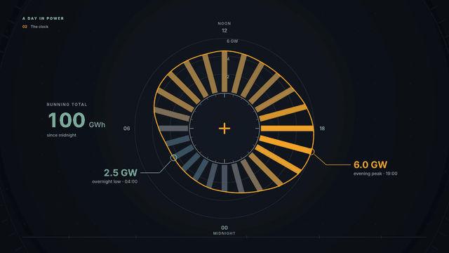

# Showcase sequences

Long, dense films written from scratch, each in several acts, with something meaningful moving at every moment. They use only the built-in `Inter Variable` and no media files, invent their products, brands and data, and pass `nakkash check` with nothing found; a test in `crates/nakkash-cli/tests/showcase.rs` keeps each one so. The [examples](../README.md) show one idea each; these show how the ideas combine at the scale of a finished piece.

## Product launch


[`product-launch.json`](product-launch.json), 1920x1080, 30 fps, 39 s. A launch film for Arclet, an invented task app, in eight acts. The beats are root `labels`; each act is a composition drawn by one `comp` layer.

| Act | Time | What happens |
|---|---|---|
| Hook | 0–3.7 s | "Everything is urgent." is readable at frame 0 while nine columns of notifications scroll past at their own depths, far ones blurred; "So nothing is." answers at 1.1 s. |
| Problem | 3.1–9.1 s | Pushed in from below. Five notifications drop onto a stack, each pushing the older ones down as one body; an unread badge rolls its count and runs to "9+". The stack folds into one card, which becomes the app's tile. |
| Reveal | 9.1–13.3 s | The tile grows into a phone's screen as the phone turns in, a light sweeps the glass, the splash wipes up and the list arrives. "Meet Arclet." |
| Priorities | 13.3–18.3 s | A chip turns "Urgent"; its row lifts, casts a deeper shadow and rises to the top while the rows it passes dim and make room. A task is checked off, struck through and sinks to the bottom; the progress bar and its count follow. |
| Focus | 18.3–24.7 s | A circular wipe from the checked box opens the focus screen as the phone swings across. Three toggles flip in turn; three alerts arrive and fly into a digest card, each leaving a dot. |
| Insight | 24.7–31.7 s | The week screen pushes in. The camera pulls back while the chart card lifts out of the phone and lands full size: the same composition at the same moment, so the hand-off is exact. Bars and gridlines grow, a trend line draws, the best day turns brand colour and gets a label. |
| Statement | 31.7–35.4 s | The best day's bar grows until it is the frame. "Less noise." assembles from scattered, turned characters; "More done." lands; rings drift behind. |
| End card | 35.4–39 s | The field closes into the tile, the mark draws on, the dot lands in a notch cut from the tile, ticks burst once, and the name, tagline and call to action settle. Complete at 37.6 s and held to the end. |

### The motion system

Every move uses one of five curves, each starting from rest so no move jumps from standing to full speed between frames:

| Curve | Used for |
|---|---|
| `cubic(.4,0,.2,1)`, 20–34 frames, longer for longer moves | entrances |
| `cubic(.65,0,.35,1)` | moves from rest to rest: re-sorts, pushes, wipes, data changes |
| `cubic(.55,0,.8,.25)` | exits: slow start, gone at speed |
| `cubic(.45,0,.55,1)` | camera, rig and long moves, one key pair each |
| `cubic(.4,0,.25,1.3)` | emphasis where something lands: 4.5 % overshoot |

Opacity follows the move it belongs to (`out-quad` in, `in-quad` out, starting a few frames after the move), and is never linear on a moving layer. Parts of a text take turns 1 to 3 frames apart (33–100 ms); grouped elements follow their leader 2 frames apart.

### What it uses

- **Text animators:** per character, word and line, with `random`, `center` and `last` orders; blur, skew, rotation, tracking and scale that clear as each part lands; a slow tracking drift over a hold; exits that are animators of their own.
- **Shapes:** repeaters that scroll the feeds (the layer stands still, its copies move) and lay out a plane of dots with two nested repeaters; `trim` on gridlines, a check mark, a trend line, a ring, an outline and the logo; `merge` `subtract` cutting the notch for the dot; `round-corners` rounding the closing field into the tile; `expand` rings and a `repeater` burst of ticks.
- **Masks and mattes:** a circular mask, its vertex count fixed, that wipes the focus screen open; a rounded mask on the phone's screen; light sweeps through a hidden screen-shaped matte.
- **Compositions:** 16, nested up to four deep. Rows, toggles and alerts are `collapse`d instances with `slots`; the app is drawn at twice its size for the pull-back; a notification stack is a parent chain, so one arrival moves every older card as one body.
- **2.5D:** a camera that drifts and pulls back with `target`; a 3D phone rig turned by a 3D pivot; feeds, a halo and a dot plane at their own depths, blurred by distance.
- **Effects and blending:** `four-color`, `ramp`, `gaussian-blur` for depth of field, `drop-shadow`, `glow`, `add` and `screen` blends, motion blur with a per-composition shutter.

### Numbers

| Measure | Value |
|---|---|
| `nakkash check` | `OK 742`, nothing found |
| Compositions, layers | 16 compositions, 170 layers written, 256 drawn once compositions are expanded |
| Animation | 284 tracks, 739 keyframes, 126 text animators, 418 shape items and effects |
| Elements in motion | 9.5 per frame on average (7.5 without the two background glows), up to 29; no frame where nothing moves; the longest stretch with only the glows moving is the 16-frame hold at the end |
| Smoothness | 25 main movers sampled every frame with `nakkash at`: no change of velocity between two frames above 25 % of the mover's peak speed |
| Paths | no turn above 10° between two frames while a mover goes faster than 10 % of its peak speed |
| Render | 289 s for 1172 frames on a 12-core laptop (about 4 frames a second), H.264 |

An element is a layer, shape item, effect, mask or text animator with a track, counted while that track moves and its layer shows.

The test runs `check`'s rules over every frame, in 6 s in a debug build. The pixel gates (`contrast`, `flash`) draw the film, which takes about 16 minutes in a debug build, so after an edit run `nakkash check` from a release build, where the whole check takes about 10 s.

To render it:

```sh
nakkash render examples/showcase/product-launch.json --out product-launch.mp4
```

## Brand identity system


[`brand-system.json`](brand-system.json), 1920x1080, 30 fps, 32 s. The identity of a fictional studio, Halvane, built in front of you: a construction sheet draws itself, the mark is made from its geometry, the wordmark sets, the palette, pattern and applications follow, and it ends on the lockup it started from. The GIF shows 13.0–19.2 s, drawn without the film's grain to stay small.

```sh
nakkash render examples/showcase/brand-system.json --out brand-system.mp4
```

| Act | Label | What happens |
|---|---|---|
| 1. Construction | `construct` 0 s | Crop marks, a ruler and guides through the golden divisions draw from their middles; five rings of radius 320/φⁿ sweep on; the golden spiral draws through them; crosshairs, dimension lines and a spec column tick in. |
| 2. Mark | `mark` 3.9 s | The tile's outline and the dot's ring draw; the tile fills as the guides fade; the bite grows out of the dot (`expand` from −75 to 122, φ² of the dot) and is cut from the tile (`merge` `subtract`), with ripples; the corners round (`round-corners` 0 → 56); a light sweep crosses it. |
| 3. Wordmark | `word` 8.7 s | The mark moves into the lockup under motion blur. Type metrics draw; the letters rise out of a baseline slot one by one, skewed and blurred, while the tracking closes from +260 to −12 over two seconds; an ember wave runs through the letters and an echo ripples from the dot. |
| 4. Colour | `palette` 13.2 s | The palette opens through the mark's own outline (two masks whose paths scale ×24 about a point in the tile) while the identity pushes in. Five swatches grow; names rise, hex codes settle in random order, RGB values tick in, and two digit wheels per swatch roll to its share; a stacked bar grows, a ring draws round the accent, a wave lifts the swatches. |
| 5. Pattern | `pattern` 17.9 s | Pushed in with motion blur. One shape layer: the mark, a repeater that turns every other copy (0 → 90°), a second that turns the pair (0 → 180°) to make a 2x2 pinwheel, and two that tile it, with a scale ramp and a slow diagonal offset. |
| 6. Applications | `apps` 22.7 s | The pattern shrinks into a sheet-framed window and becomes a display; the camera pulls back past a phone and two business cards to a wayfinding sign in one move, over a drafting-grid floor, with a pane of registration crosses close to the lens. |
| 7. Lockup | `lockup` 28.7 s | The sign's dot grows to fill the frame and closes into the lockup's dot; the tile, wordmark and tagline arrive, construction rings redraw round the dot, crop marks return, and a sweep crosses the word. Complete at 30.7 s, holding 1.3 s while the rings and sweep finish. |

**The motion system.** Every move uses one of five curves, and durations grow with distance (12 frames plus one per 40 px, up to 30):

| Curve | Used for |
|---|---|
| `cubic(.16,1,.3,1)` | entrances: fast off the mark, long settle |
| `cubic(.7,0,.84,0)` | exits |
| `cubic(.65,0,.35,1)` | moves from rest to rest, relayouts, bites, turns |
| `cubic(.45,0,.2,1)` | line draws |
| `in-out-sine` | the camera and drifts, one key pair each |
| `out-back(1)` | landings only, 3.7 % overshoot |

Staggers are 2 frames (67 ms). A move leads and its fade follows: opacity has its own animator or track, on `out-sine`, never linear on a moving thing.

**What it uses.** Text animators by character and word with `range` selectors in fraction and `index` units, `ease-high`/`ease-low` on a `triangle` wave, `tracking`, `blur`, `skew`, random `order` with `seed`; trims with offsets, `merge` `subtract`, `round-corners`, `expand` with `copies` and `copy-offset`, four nested repeaters; masks with keyed paths and track mattes; ten compositions with slots and `overrides` (the digit wheel is one composition used ten times), pivots and parenting; a 2.5D camera with `target`, `target-z` and `orient`, 3D planes and shadow planes; `remap` (the display keeps playing the pattern, slowing to a stop); `fractal-noise` grain under `overlay`, `glow`, `gaussian-blur`, `screen` sweeps; motion blur on pivots, pushes and compositions; `in`/`out` presets and labels.

**Numbers.** 152 layers in 10 compositions, 649 keyframes. On average 8.1 animated values are changing in any frame, and no second has fewer than 2.8. `nakkash check` prints `OK 488`. Sampled every frame with `nakkash at`, the mark's move, the palette's push, the pattern's push and scale, and the camera have no frame-to-frame speed change above 25 % of their peak. The zoom into the palette, evaluated from its curve, accelerates smoothly into its cut. Of the 58 joins in the scene's curved paths, none turns by more than 10°. Rendering takes 95–210 s on an M-series Mac, depending on load.

## Data story

[`data-story.json`](data-story.json), 1920x1080, 30 fps, 38.2 s. An editorial explainer about one fictional city's day of electricity, on illustrative data that the end card labels as such. Every number on screen comes from one hourly table, so the acts agree: the clock's bars sum to the running total, the twelve districts add up to the city at every hour, and the sectors add up to the city at 09:00 and 19:00.



| Act | Label | What moves |
|---|---|---|
| 1 | `open` | `2.4×` counts up from `1.0` on odometer wheels, the sentence rises word by word with highlight sweeps, and the × flies to the clock's centre, turning into its crosshair. |
| 2 | `clock` | A 24-hour clock with noon at the top: its ring, grid rings and ticks build (trims, repeaters), a hand with a fading wake (a repeater of wedges) leads the bars round, a running total counts to 100 GWh, and callouts mark the peak and the low. |
| 3 | `curve` | The clock unrolls into the line chart, a match cut through shared geometry: its ring becomes the x axis, its bars the columns, its outline the demand line. Gridlines and labels build, the solar series draws with its legend riding the drawing head, and a cursor scrubs the day hour by hour while its readout's digits roll. The evening band then grows into the next act's panel. |
| 4 | `mix` | Stacked bars by sector at 09:00; the clock in the corner rolls to 19:00, the bars re-measure, and the rows re-sort: falling rows step into a dimmed left lane, rising rows travel a near lane, three at a time at most. A sheen crosses the new leader. |
| 5 | `grid` | Twelve district cards in 3D, seen through a camera that pulls back from the first card in one key pair. Each card shows once it is wholly inside the title-safe area, and the two exceptions dim. |
| 6 | `close` | The takeaway in kinetic type (per-character skew, blur and a tracking wave bent by `ease-high` and `ease-low`, words rising), an underline, the day's curve as a signature, and the end card. |

**Motion system.** One set of curves runs the piece: entrances `cubic(.16,1,.3,1)`, exits `cubic(.7,0,.84,0)`, moves on screen `cubic(.55,0,.45,1)`, the camera and the unroll `cubic(.45,0,.55,1)`, and `out-back(1)` (3.7 % overshoot) only where a mark lands. Durations grow with distance (12 frames at 40 px, 19 at 200, 27 at 1500), staggers are 2 frames (67 ms), and fades start after their move and never run linear.

**Counting numbers.** The format has no expressions, so every number that counts is an odometer: a composition whose canvas is the window, holding one text layer per digit with its digits one per line, rolled by a text animator's `position`. A second animator leaves the rows outside the window faint, so `check` does not read hidden digits as text running into their neighbours.

**The unroll.** Path keys move vertex by vertex, so a circle cannot bend into a line by two keys. The generator bakes the unroll, an arc whose length and turn change together, as one key a frame for the three paths that carry it.

The scene is written by a generator kept outside the repository; the JSON is its output, formatted to be read.
